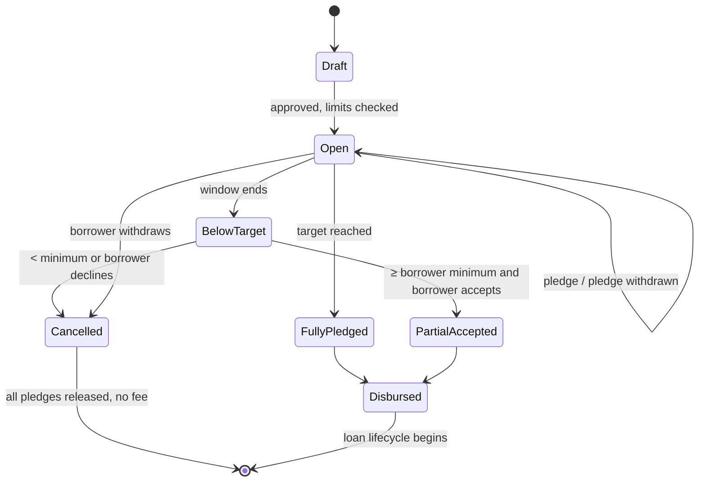
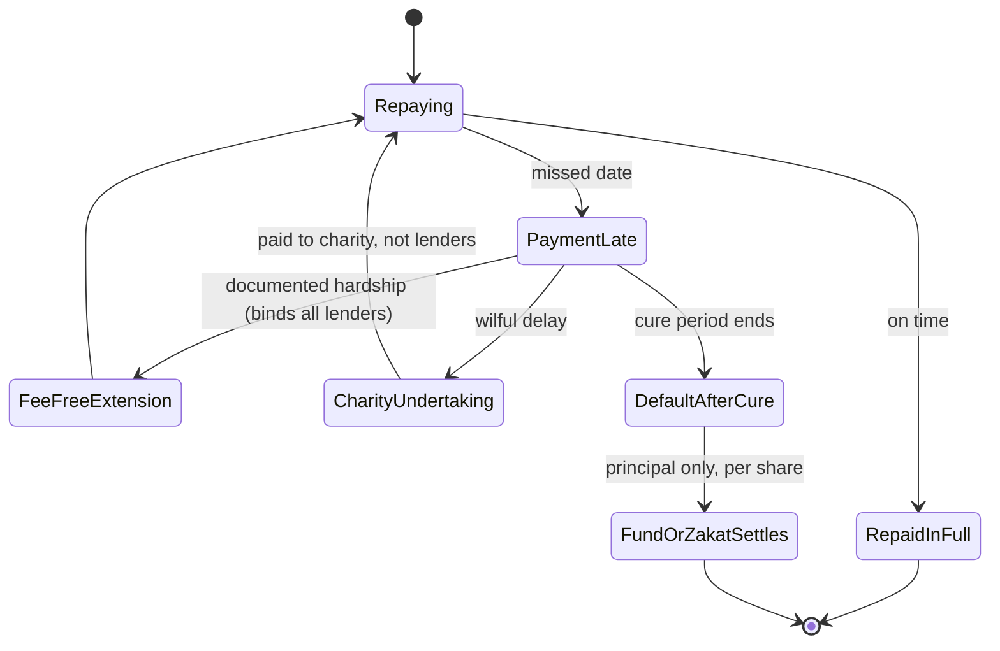

# Shariah-Compliant Community Finance Platform — Specification

Oct 13, 2026 · Taha Abdul-Basser, Managing Partner, Straightway Ethical Advisory

**Crowd-lending design.** In this design a borrower's request is funded by **one or more lenders**. It works like a LaunchGood campaign, except that backers make qard hasan loans instead of donations. The platform matches borrowers to lenders. It then collects each repayment once and distributes it pro rata to every lender on the loan.

The platform keeps SoLo Funds' community model, in which neighbours fund neighbours' small emergency needs. It lets a whole community share each loan, and it removes every riba channel: no tips, no lender-side increments, no fee-for-guarantee, no fee on the qard itself and no lender priority for sale. Lenders who want a return get it through asset-backed murabaha, not through the loan.

## Purpose, scope and assumptions

This is a product, Shariah and technical specification for a US consumer crowd-lending platform for small-dollar needs. It is written to be handed to a Shariah board for fatwa and to an engineering team for build.

- **In scope:** a fee-free crowd-funded qard hasan marketplace (the core), matching and auto-lending, pro-rata repayment distribution, hardship and default handling, a mutual (tabarru') protection fund, a zakat relief channel, and a later murabaha module for specific purchases.
- **Out of scope:** cash financing via tawarruq, earned-wage access, credit cards, any interest-bearing deposit product, and a secondary market in loan shares.
- **Assumptions:** US-only launch; consumer borrowers; first loan capped at $100 and maximum loan size $5,000; minimum lender contribution $5 (provisional); a bank partner (target: Stearns Bank, N.A., through its Stearns Salaam Islamic division) holds all funds, including pledges awaiting disbursement; all contract templates are approved by a Shariah board before use.
- **Status:** working draft for Shariah and legal review. Nothing here is legal advice. US counsel is Musa Abdul-Basser, Partner at Hayes Law and Compliance and Of Counsel to NOVA Business Law Group (engaging firm to be confirmed). The review is commissioned through two briefs, both updated for the crowd-lending design: [to US counsel](brief-counsel.md) and [to the Shari'a Board](brief-shariah-board.md).

## Reference models

The design draws on three existing products. SoLo supplies the community emergency-loan use case, LaunchGood supplies the campaign and crowd mechanics, and Kiva shows that zero-return crowd loans can work.

| Model | What it is | What this platform takes from it | What it rejects |
| --- | --- | --- | --- |
| SoLo Funds | P2P emergency cash loans, one lender per request | Small-dollar emergency use case, graduated limits | Tips, loan-linked donations, paid default protection |
| LaunchGood | Muslim community crowdfunding for donations | Campaign page, community sharing, funding progress | Donation-only economics (here backers lend) |
| Kiva | Crowd-funded loans at 0% to lenders, repaid to lenders in proportion to their share | Small minimum contributions, pro-rata repayment, re-lending of repaid funds | Any intermediary interest charged to the end borrower |

### How SoLo Funds works

SoLo is a P2P marketplace where members post short-term cash requests and other members fund them. Its economics run on optional payments layered on top of a nominally interest-free loan.

| Feature | How it works at SoLo |
| --- | --- |
| Loan size | Up to $625; first-time borrowers capped at $100 ([MoneyLion review, May 2026](https://moneylion-next.moneylion.com/learn/personal-loans/reviews/solo-funds-app)) |
| Lender return | Borrower's optional tip, paid to the lender; SoLo reports an average tip of 10.4% (same source) |
| Platform revenue | Borrower's optional donation to SoLo |
| Default cover | SoLo Protect, an optional paid add-on |
| Scale | Nearly 2M users; over $1B in transactions, per the company |

**Regulatory history.** Several states brought cases over how the tip and donation model was marketed, and Pennsylvania settled one. A federal judge denied SoLo's motion to dismiss the CFPB suit in October 2024, and the CFPB dropped the case in February 2025 ([Wikipedia](https://en.wikipedia.org/wiki/SoLo_Funds)). The core allegation was that "optional" payments were in effect expected, which is the same defect a Shariah analysis finds.

## Shariah analysis of the reference model

The SoLo loan is a qard, so any benefit that flows to the lender because of the loan is riba al-qard (*kull qard jarra nafʿan fa-huwa riba*). Calling the benefit "optional" does not cure it when the platform makes it customary and lets it drive funding (*al-maʿrūf ʿurfan ka-l-mashrūt sharṭan*).

| SoLo feature | Characterisation | Ruling | Replacement |
| --- | --- | --- | --- |
| Tip to lender | Increment on a qard, solicited at origination and visible to lenders when choosing loans | Impermissible | Removed entirely; lender return only via murabaha module |
| Donation to platform | Benefit to the intermediary tied to a loan request | Impermissible as designed | No loan-linked fee; the platform earns only from services separately rendered |
| Paid default protection | Guarantee for a fee (*kafāla bi-ajr*) / commercial insurance | Impermissible | Tabarru'-based mutual protection fund |
| Late fees to lender | Increment for delay | Impermissible (riba al-nasī'a) | Charity undertaking; hardship extension |
| Lender-paid platform fee | Agency fee (*wakāla bi-ajr*) paid by the creditor | Permissible | Kept |
| Interest on wallet float | Riba | Impermissible | Non-interest custodial accounts; any accrual purified |

**What remains permissible.** A borrower may voluntarily repay more at settlement if the extra is unstipulated, unsolicited and not customary on the platform (*ḥusn al-qaḍā'*). The product must therefore never prompt, display or rank by such payments. The simplest rule is not to accept them through the platform at all.

## Shariah analysis of the crowd structure

Crowd funding adds four questions that a single-lender qard does not raise. They are when the qard comes into being, how the lenders hold the debt between them, how repayments are shared, and whether any lender can gain an advantage over the others. The positions below are proposed for the board's ruling.

**1. Pledge, then qard.** A lender's commitment to a campaign is a promise to lend (*waʿd*), not a qard. The pledged money sits in a non-interest custodial account in the lender's name and remains the lender's property (*amāna*). The lender may withdraw the pledge until the campaign closes. The qard is formed only at disbursement, when the borrower takes possession (*qabḍ*). If the campaign fails, no qard ever existed and the pledges are released in full.

**2. Characterisation of the lenders' holding.** There are two candidate structures, and the board is asked to choose between them.

| Option | Structure | Consequence |
| --- | --- | --- |
| (a) Parallel qards (proposed) | Each lender makes a separate qard of their own contribution to the borrower. One master agreement documents all of them, and the platform is each lender's agent for collection (*wakīl bi-l-qabḍ*). | Each lender's claim is distinct. Pro-rata sharing is a term of the agency that every lender accepts at pledge. One lender's forgiveness or protection-fund claim does not touch the others. |
| (b) Joint debt (*dayn mushtarak*) | The lenders jointly hold one debt from a single disbursement out of commingled funds. | On the view that what one co-creditor receives from a shared debt is shared with the others, pro-rata sharing follows from the contract itself. Individual forgiveness and transfer then need separate rules. |

Option (a) is proposed because it keeps each lender's position separable, which matters for forgiveness, protection-fund claims and estates. Under both options every repayment is split pro rata.

**3. Pari passu, with no priority for sale.** Every lender on a loan ranks equally. No lender may be repaid ahead of the others, and the platform must never offer earlier or senior repayment in exchange for a fee, a larger pledge or membership. Bought priority is a benefit to the creditor tied to the loan. Size of contribution changes a lender's share of each repayment, never its timing.

**4. One borrower obligation, one schedule.** The borrower owes one schedule, makes one payment and deals with one counterparty in practice (the platform as agent). Hardship relief is mandatory (*fa-naẓiratun ilā maysara*, al-Baqara 2:280), so a hardship extension binds every lender on the loan. No lender can opt out of it, and no lender can demand faster repayment than the others.

**5. Individual forgiveness.** Any lender may forgive (*ibrā'*) part or all of their own share at any time, as sadaqa. Forgiveness reduces only that lender's share. The borrower's schedule is reduced by that amount and the other lenders' entitlements are unchanged. The platform may offer forgiveness as an action to the lender, but it must never prompt the borrower to ask for it or rank borrowers by how much they have been forgiven.

**6. Transfer of a share.** No secondary market is offered. A lender's share passes to their estate on death. A transfer to another member during the loan's life, if ever allowed, is at face value only (*ḥawāla* of the debt) and never at a discount (*bayʿ al-dayn*). Transfers are excluded from the MVP and left for the board.

**7. Gifts alongside loans (open).** A campaign could also accept outright gifts (sadaqa) to the borrower that reduce the amount to be borrowed, as on LaunchGood. Gifts go to the borrower and never to the lenders or the platform. This is an open decision because it mixes giving and lending on one page, which raises UDAAP and dignity questions.

## Compliant product modules

Five modules replace SoLo's single tip-funded loan. Module A is the crowd-funded core. Modules B–E add what the tip was doing (lender motivation, default cover, platform revenue) through permissible contracts.

| Module | Contract | Who funds | Lender return | Phase |
| --- | --- | --- | --- | --- |
| A. Community crowd-qard | Qard hasan, one or more lenders per loan, platform as collection agent | Individual members | None (reward, community standing) | 1 |
| B. Mutual protection fund | Tabarru' pool, platform as wakīl | Opt-in lenders' contributions | None; surplus per fund rules | 2 |
| C. Zakat relief circle | Zakat to *al-ghārimīn* | Zakat payers | None | 2 |
| D. Goods murabaha | Agency purchase + deferred-price sale | Investor pool | Fixed markup agreed upfront | 3 |
| E. Service ijara | Service acquisition and re-provision (*ijāra mawṣūfa fī al-dhimma*) | Investor pool | Fixed rental margin | 4 |

### A. Community crowd-qard (core)

1. **Campaign.** The borrower posts a campaign with the target amount, the minimum amount they can use, a purpose category, the proposed repayment schedule and an optional story. No tip field exists in the schema. The borrower chooses how much of their identity and story to show; the default is first name and purpose category only (*sitr*, concealment of a believer's need).
2. **Funding window.** The campaign is open for a fixed window (provisional: 7 days, shorter for urgent categories). Lenders pledge in multiples of the $5 minimum, and a single lender may fund the whole amount. Pledges are capped at the target, so overfunding is impossible.
3. **Matching.** Lenders reach campaigns two ways:
   - **Browse:** campaigns are ranked only by need, fit, time remaining and borrower track record, never by anything a lender gains.
   - **Auto-lend:** a lender sets a budget and criteria (purpose, location, loan size), and the matching engine allocates their funds across eligible campaigns in $5 slices, spreading each lender across many loans by default.
4. **Close.** When the target is reached, the campaign closes and disburses. If the window ends below target but at or above the borrower's stated minimum, the borrower may accept the partial amount. Otherwise every pledge is released in full, with no fee charged to anyone.
5. **Disbursement.** One master qard agreement is signed. It names the borrower, each lender and each lender's share, and it appoints the platform as collection agent. The principal moves to the borrower and each lender's pledge becomes their qard.
6. **Repayment.** The borrower repays exactly the principal on one schedule and nothing more. No fee is charged to the borrower on the qard. Each payment received is distributed the same day to every lender in proportion to their share (see *Repayment distribution*).
7. **Recycling.** Repaid funds land in the lender's wallet. With auto-lend on, they are re-lent to new campaigns. Otherwise they can be withdrawn.

Lender motivation is non-financial by design. It comes from impact dashboards ("you helped 14 neighbours"), reputation badges, and the social momentum of a campaign filling up.

**Speed trade-off.** A crowd fills more slowly than one lender, and many needs are emergencies. Auto-lend is the mitigation: standing lender budgets let the matching engine fund a qualifying first-time $100 request within minutes, without waiting for browsing lenders.

### Repayment distribution

Every borrower payment is split across the lenders by the same deterministic rule, so that each lender receives exactly their principal over the life of the loan and never a cent more.

- **Shares.** Each lender's share is their contribution divided by the total disbursed, stored as an exact fraction.
- **Allocation.** On each payment, a lender's cumulative entitlement is their share × cumulative payments, rounded down to the cent. The leftover cents go to the lenders with the largest fractional remainders, with ties broken by earliest pledge. This is the largest-remainder method on cumulative totals, so rounding never drifts and the final payment settles every lender to exactly their contribution.
- **Partial and early payments** follow the same rule. An early payoff simply ends the loan sooner for everyone.
- **Forgiven shares** are removed from the denominator from the date of forgiveness. The borrower's outstanding balance falls by the forgiven amount and the remaining lenders' cents are unchanged.
- **Protection-fund payouts** (Module B) pay out only the shares of opted-in lenders. The fund then stands in those lenders' place for later recoveries on those shares.
- **Zakat settlement** (Module C) clears the borrower's outstanding balance and is distributed pro rata like any other payment.
- **Lender accounts** that are closed or frozen (for example by sanctions or death) still accrue entitlements, which are held for the lender or estate and never redistributed to other lenders.

### B. Mutual protection fund

Lenders who opt in donate a small contribution per pledge into a pool held on a tabarru' basis. Opt-in is per lender, so a loan can carry a mix of covered and uncovered shares. The pool reimburses principal shortfall on the covered shares of defaulted qard according to published rules. The platform manages it as wakīl for a fixed, disclosed fee and never guarantees principal itself.

### C. Zakat relief circle

Zakat payers give into a ring-fenced pool used to clear the qard of eligible borrowers in genuine hardship, under the *ghārimīn* category. Eligibility is assessed through the platform's hardship process against the Shariah board's criteria. The pool may settle the outstanding balance of a qard that is otherwise unrecoverable where the borrower qualifies as *ghārim*. The settlement is shared pro rata among all of that loan's lenders. A lender cannot direct their own zakat to settle a debt owed to them. Zakat donors therefore cannot earmark gifts to a campaign, and the allocation engine excludes a donor's gifts from any loan in which that donor holds a share.

### D. Goods murabaha

For a specific purchase (tyres, a laptop, an appliance), the investor pool buys the item from the merchant through the platform as agent, using a merchant-locked virtual card. It takes constructive possession, then sells the item to the member at cost plus a fixed markup, payable in instalments. The price is fixed at contract, with no rollover, no rate reset and no late increment. Cash disbursement through tawarruq is excluded through phase 3, to be reconsidered after phase 3.

### E. Service ijara

For bills such as car repair or tuition, the pool contracts for the service from the provider and re-provides it to the member at a fixed deferred price. This needs provider integration and is the last module to ship.

## Participants, flows and state machines

Four parties transact: the borrower, one or more lenders, the platform (as service provider, matching engine and collection agent), and the bank partner holding funds. Investors and zakat donors join in later phases.

**Campaign lifecycle**

**Loan lifecycle (applies to the whole loan; every lender is treated alike)**

Each lender's share also carries its own status (Active, Forgiven, FundReimbursed, Settled), but nothing a lender does to their own share changes another lender's position. Every path out of a late payment ends with each lender receiving at most their principal: hardship gets time, wilful delay pays charity, and default is covered by the fund (for opted-in shares) or the zakat pool.

## Platform revenue model

The platform earns nothing on the qard itself. There is no borrower fee, no allocated overhead and no cost recovery. Every stream below is a service separately rendered to the party it benefits, and none is charged to the borrower.

| Stream | Payer | Contract | Compliance condition |
| --- | --- | --- | --- |
| Lender agency fee | Each lender | Wakāla bi-ajr (matching, collection, distribution) | May be a % of the lender's own contribution, charged at disbursement on top of the pledge and never deducted from the borrower's payments. Not charged if a campaign fails |
| Protection fund fee | Fund | Wakāla bi-ajr | Fixed % of contributions, disclosed; no share of surplus unless board approves an incentive fee |
| Murabaha agency fee | Investor pool | Wakāla bi-l-istithmār | Fixed fee, optional incentive above a target profit |
| Membership (optional) | Member | Ijāra of platform access | Flat monthly; must not be required to borrow, scaled to borrowing, or buy lender priority |

**Not permitted:** any borrower fee on the qard, donations solicited in the campaign or loan flow, revenue share on any lender increment, interest on float (including pledges awaiting disbursement), paid repayment priority, and sale of receivables or loan shares at a discount.

**Purification:** any impermissible income (e.g. bank interest credited despite controls) is booked to a purification ledger and paid to charity quarterly, with a report to the board.

## Risk, default and collections

Delay is never monetised for any creditor. Hardship triggers an extension (*fa-naẓiratun ilā maysara*, al-Baqara 2:280), and wilful delay triggers a charity undertaking, not a fee.

- **Underwriting:** cash-flow underwriting from linked bank data; graduated limits that start at a low first-loan cap and rise with on-time history; one open campaign or active loan per borrower; fraud, KYC and sanctions screening at onboarding for borrowers and lenders.
- **Campaign integrity:** stories are reviewed before publishing; there are no off-platform payment links; and a borrower cannot pledge to their own campaign, directly or through related accounts.
- **Lender concentration:** auto-lend spreads each lender across loans by default. Lenders are shown their exposure, and an optional per-loan cap applies.
- **Late payment:** no late fee to any lender or the platform. The borrower may undertake at signing to donate a fixed amount to charity if late without excuse (*iltizām bi-l-taṣadduq*, AAOIFI SS 3). Proceeds go to the charity account, never to lenders or revenue. Documented collection costs are not charged to a wilfully late borrower (board ruling).
- **Hardship:** self-declared hardship opens a case. Documented hardship gets a mandatory, fee-free extension and a revised schedule that apply to every lender's share. Eligible cases are referred to the zakat relief circle. Lenders are told that an extension was granted but never told why.
- **Default:** after a defined cure period, the protection fund reimburses principal on opted-in shares, and the borrower then owes those shares to the fund. Uncovered shares remain owed to their lenders.
- **Collections:** the platform collects for all lenders as one agent, so lenders never contact the borrower directly. Collection is done through a fixed-fee or *juʿāla* agency only, and defaulted qard is never sold to third parties at a discount (*bayʿ al-dayn*).
- **Credit reporting:** permitted, and disclosed at signing.
- **Wilful-default restrictions:** loss of borrowing access and reputation, never a monetary increment. Defaulters are never named on public campaign pages.

## Shariah governance

No module, contract template or fee change goes live without a written board resolution, and the board's rules are enforced in code, not only in policy.

**Straightway Ethical Advisory is the platform's Shari'a Advisor and will provide the Shari'a Board.** Sh. Taha Abdul-Basser is the executive liaison for the Shari'a Board. In that capacity he answers the board's questions on the product's design, economics and technical implementation during this stage of development, and routes questions and rulings between the board, the product team and US counsel. The board is briefed through the [Shari'a Board brief](brief-shariah-board.md).

- **Shariah supervisory board:** at least three qualified scholars (AAOIFI GS 1), constituted by the Shari'a Advisor, with a fatwa per module and a Shariah policy manual.
- **Internal Shariah review:** a compliance officer tests live transactions against the manual monthly, including a sample of distribution runs.
- **External Shariah audit:** annual, by an independent firm that is not the board's advisor or the product designer.
- **Change control:** product, pricing, matching-algorithm and contract changes route through a board-approval workflow in the admin console.
- **Rules as code:** board rulings compile to a versioned rules engine. Example rules are "each lender's cumulative receipts ≤ that lender's contribution", "distribution is pro rata on every payment", "no lender-visible field derived from borrower payments above principal" and "no allocation of a donor's zakat to a loan the donor holds a share in". A failing rule blocks the transaction and alerts compliance.
- **Disclosure:** each contract shows its contract type, the lender's share, the pro-rata rule and the board's approval reference.
- **Conflicts:** Sh. Taha Abdul-Basser also sits on the Shari'a Supervisory Board of Stearns Salaam, the target bank partner's Islamic division. The overlap is disclosed to both boards and to counsel; he recuses from Stearns Salaam's review of this programme; and commercial terms with the bank are negotiated by the operator with counsel.

## US regulatory considerations

Removing interest does not remove lending regulation. The qard is still a consumer loan, although it carries no finance charge. Crowd funding adds a further question: whether lender shares are securities. P2P lenders that sold interest-bearing loan notes to many investors have historically had to register those notes with the SEC. Here lenders receive no return, which is the strongest argument that their shares are not securities, but counsel must confirm it. Each item below needs counsel's confirmation.

| Area | Applies to | Working position |
| --- | --- | --- |
| Securities (SEC / state) — lender shares | A | Zero-return qard shares lack an expectation of profit; confirm they are not notes or investment contracts (Howey / Reves), including with auto-lend and pooled distribution |
| State lending licences / small-loan laws | A, D, E | Crowd lenders should not each need a licence. Either originate through a bank partner, with lenders acquiring shares at par, or license the platform as lender of record with a back-to-back qard. The Shariah treatment of each route needs board review |
| TILA / Reg Z | A, D, E | No finance charge on the qard; murabaha markup disclosed as finance charge with APR |
| State retail instalment sales acts | D | Murabaha likely a credit sale; follow RISA disclosure and fee rules |
| Securities — investor side | D, E | Notes or pool interests with an expected return are likely securities; plan for Reg A+ / Reg CF or a bank-held pool |
| Money transmission | Pledges, wallet, distributions | Pledges and repayments held in a bank partner's FBO accounts, never by the platform directly |
| Crowdfunding / solicitation | Campaign pages | Campaign pages solicit loans, not donations; confirm no charitable-solicitation registration is triggered (and confirm if gifts are added) |
| ECOA / Reg B, FCRA | All | Adverse-action notices; permissible-purpose pulls; accurate furnishing; matching must not produce disparate impact |
| EFTA / Reg E | Autopay | Revocable ACH authorisations |
| BSA / AML, GLBA | All | KYC on lenders and borrowers; monitoring for circular funding; privacy controls on campaign stories |
| UDAAP | All | No "optional" payments that are in effect expected (SoLo's enforcement history); campaign progress and social features must not pressure borrowers |

Zakat and protection-fund contributions also need charitable-solicitation and insurance-law review in each state.

## Technical architecture and data model

The platform is a mobile-first app on a service backend. A double-entry ledger is the source of truth, and a Shariah rules engine sits in the transaction path.

| Service | Responsibility | Shariah-relevant control |
| --- | --- | --- |
| Identity & KYC | Onboarding, ID verification, sanctions (borrowers and lenders) | — |
| Bank data | Account linking, cash-flow features | — |
| Underwriting | Limits, graduation, fraud scores | Ranking inputs exclude any lender-benefit field |
| Campaigns | Campaign pages, stories, funding window, close and cancel | No tip/donation fields; privacy defaults |
| Matching engine | Browse ranking, auto-lend allocation | Ranking and allocation audit log; no paid priority |
| Contract engine | Generates and e-signs board-approved master qard agreements | Template version tied to board resolution ID; share table embedded |
| Shariah rules engine | Evaluates every money movement before posting | Blocks any lender receipt above their contribution |
| Ledger | Immutable double-entry; pledges, principal shares, other-service fees, charity, fund and zakat as separate books | Segregated charity and purification accounts |
| Distribution | Splits each borrower payment across lender shares | Deterministic largest-remainder allocation; replayable |
| Payments | ACH, debit push, RTP via bank partner FBO | Non-interest accounts only |
| Servicing & hardship | Schedules, reminders, extensions, cases | Extensions cannot add charges; apply to all shares |
| Funds | Protection fund and zakat pool accounting | Ring-fenced; claims per published rules; zakat self-dealing check |
| Murabaha ops (phase 3) | Merchant-locked virtual cards, ownership record | Purchase must post before sale contract |
| Admin & board console | Approvals, rulings, reports, purification | Change control workflow |

**Core entities:** Member, Role, CreditProfile, Campaign, Pledge, AutoLendRule, QardContract, LoanShare, Distribution, Forgiveness, MurabahaContract, Asset, Installment, Payment, LedgerEntry, Fee, HardshipCase, FundContribution, FundClaim, ZakatGift, CharityUndertaking, PurificationEntry, ShariahRuling (versioned).

**Invariants enforced at the ledger:**

- The sum of LoanShare contributions equals the disbursed principal.
- The sum of borrower payments on a qard is at most the principal (net of forgiveness), and equals it exactly at full repayment.
- For every LoanShare, cumulative distributions are at most the contribution, and equal it exactly when the loan is repaid in full.
- Each payment's distribution sums exactly to the payment, with no residue held by the platform.
- A pledge is never commingled with platform funds and earns nothing while pending.
- Murabaha sale price is immutable after signing; restructuring may reduce it, never raise it.
- A murabaha sale cannot exist without a prior purchase entry for the same asset.
- Charity-undertaking receipts post only to the charity account.
- Every contract references an active ShariahRuling.

## Phasing / MVP

The MVP is the crowd-qard marketplace with browse. It needs no investor-side securities structure, and it proves demand before return-bearing products. The [business plan](business-plan.md) compresses phases 0 and 1 into Q4 2026 through an invite-only pilot in one state.

| Phase | Ships | Gate to start |
| --- | --- | --- |
| 0. Foundations | Board appointed, policy manual, counsel opinion (including lender-share securities question), bank partner | — |
| 1. MVP | Module A (crowd campaigns, browse, pro-rata distribution), hardship flow, charity and purification ledgers, launch states per Decisions | Fatwa on A including the crowd structure; lending licence or bank-partner programme |
| 1b. Auto-lend | Matching engine auto-allocation, re-lending of repayments | Board approval of allocation rules; counsel sign-off on auto-lend under securities analysis |
| 2. Safety net | Modules B and C | Fatwa on B and C; insurance and charitable-solicitation review |
| 3. Returns | Module D, investor onboarding | Fatwa on D; securities exemption or bank-held pool; merchant network |
| 4. Services | Module E | Fatwa on E; provider integrations |

## Decisions

Resolved for the earlier single-lender draft and carried into the crowd-lending design. The Board rulings are provisional and are presented to the Shari'a Board as R1–R5 in the [Shari'a Board brief](brief-shariah-board.md).

- **Qard fee (Board):** removed in full. No borrower fee, no allocated overhead and no cost recovery is charged on the qard.
- **Collection costs (Board):** not recoverable. Documented collection costs are not charged to a wilfully late borrower.
- **Tawarruq (Board):** excluded for cash needs through phase 3; to be reconsidered after phase 3.
- **Protection-fund surplus (Board):** carried forward in the fund. It is neither refunded to participants nor paid to charity.
- **Zakat settlement of unrecoverable qard (Board):** permitted. Where a defaulted borrower qualifies as *ghārim*, the zakat pool may clear the outstanding qard, including to the creditor-lenders, pro rata. No lender may direct their own zakat to a debt owed to them.
- **First-loan cap and maximum loan (Product):** first loan capped at $100; maximum loan size $5,000.
- **Launch states (Product):** New York, New Jersey, Pennsylvania, Michigan, Illinois, Texas, California, Minnesota.
- **Community channels (Product):** mosques, MSAs and community groups as outreach channels only. There are no lending circles: every lender is an individual member.

Provisional for the crowd-lending design (Product):

- **Minimum contribution:** $5. A single lender may fund 100% of a campaign.
- **Funding window:** 7 days by default, shorter for urgent categories.
- **Partial funding:** accepted only at or above the borrower's stated minimum and with the borrower's consent; otherwise pledges are released in full.
- **Distribution:** pro rata on every payment, using the largest-remainder method on cumulative totals.
- **Q4 2026 pilot (per the [business plan](business-plan.md)):** invite-only, one state chosen by counsel, about 50 borrowers and 200 lenders, pilot maximum loan $500, total book capped at $25,000, lender agency fee waived for the pilot.

## Open decisions

- [ ] Shari'a Board: characterisation of the crowd holding, parallel qards with a collection agency (proposed) or joint debt (*dayn mushtarak*). Q32 in the [Shari'a Board brief](brief-shariah-board.md).
- [ ] Shari'a Board: confirm pledge-as-*waʿd*, with the qard formed at disbursement, and that a hardship extension binds all lenders. Q31 and Q35 in the [Shari'a Board brief](brief-shariah-board.md).
- [ ] Shari'a Board: whether a lender's share may ever be transferred to another member at par (*ḥawāla*), or only pass by inheritance. Q37 in the [Shari'a Board brief](brief-shariah-board.md).
- [ ] Shari'a Board: Shariah treatment of bank-partner origination followed by lenders acquiring shares at par. Q39 in the [Shari'a Board brief](brief-shariah-board.md); A4 and A10 in the [counsel brief](brief-counsel.md).
- [ ] Product + Board: whether campaigns may also accept gifts (sadaqa) to the borrower alongside loans. Q40 in the [Shari'a Board brief](brief-shariah-board.md); D6 in the [counsel brief](brief-counsel.md).
- [ ] Product: how much of a borrower's story and identity may be shown, balancing funding speed against *sitr* and privacy. Q40 in the [Shari'a Board brief](brief-shariah-board.md); D6 in the [counsel brief](brief-counsel.md).
- [ ] Counsel: whether zero-return lender shares, with or without auto-lend, are securities. Part D (D1–D3) of the [counsel brief](brief-counsel.md).
- [ ] Counsel: lending licence by state vs bank-partner origination for the qard — response deferred. Framed as Part A of the [counsel brief](brief-counsel.md), including A2 on multiple lenders and A10 on the Platform as lender of record.
- [ ] Counsel: securities route for the murabaha investor pool — response deferred. Framed as Part B of the [counsel brief](brief-counsel.md).
- [ ] Shari'a Board: Module A fatwa (fee-free crowd-qard, charity undertaking, hardship, collections, ranking and matching) — blocking for phase 1. Q4–Q13 and Q31–Q40 in the [Shari'a Board brief](brief-shariah-board.md).
- [ ] Shari'a Board: confirmation of the five provisional rulings R1–R5 recorded in Decisions.
- [ ] Shari'a Board: division of review between this Board and Stearns Salaam's Shari'a Supervisory Board. Q42 in the [Shari'a Board brief](brief-shariah-board.md).
- [ ] Counsel + operator: Stearns Bank programme structure (direct or through a programme manager; origination role) and pilot state. A12 in the [counsel brief](brief-counsel.md).

## Sources

- [SoLo Funds App Review (2026), MoneyLion](https://moneylion-next.moneylion.com/learn/personal-loans/reviews/solo-funds-app)
- [SoLo Funds, Wikipedia](https://en.wikipedia.org/wiki/SoLo_Funds)
- [SoLo Funds company profile, ZeroG Talent](https://zerogtalent.com/ai-companies/solo-funds)
- [LaunchGood](https://www.launchgood.com) — campaign model reference
- [Kiva](https://www.kiva.org) — crowd-funded zero-return lending reference
